# XAUUSD intraday backtest report

## Verdict

- **london_breakout: INCONCLUSIVE (positive out-of-sample, but not convincing)**
- **ny_momentum: IN-SAMPLE ONLY (does not survive out-of-sample)**
- **vwap_fade: NO EDGE (loses even in-sample after costs)**
- **lb_trend: INCONCLUSIVE (positive out-of-sample, but not convincing)**
- **lb_confirm: NO EDGE (loses even in-sample after costs)**
- **lb_early_exit: INCONCLUSIVE (positive out-of-sample, but not convincing)**
- **lb_tight_range: INCONCLUSIVE (positive out-of-sample, but not convincing)**
- **regime_switch: NO EDGE (loses even in-sample after costs)**

Bottom line: none of the 8 strategies shows an edge that survives costs, out-of-sample data, walk-forward re-optimisation and parameter perturbation. Do not trade them as specified.

Verdict rules (fixed before running): an edge requires positive walk-forward OOS expectancy with t-stat >= 2.0 over >= 30 trades, positive default-parameter OOS expectancy, still positive at 2x spread+slippage, and >= 60% of the parameter grid positive.

## regime_switch: pre-registered adoption decision

**NOT ADOPTED** (rule fixed in [docs/regime-switch-test.md](docs/regime-switch-test.md) before the run)

- ❌ development window: EDGE AFTER COSTS under the lab's rules (got NO EDGE (loses even in-sample after costs))
- ❌ walk-forward expectancy above the baseline london_breakout's (got -0.026R vs +0.054R)
- ✅ holdout covers >= 12 months (got 23.7)
- ✅ holdout trades >= 30 (got 131)
- ❌ holdout expectancy > 0 (got -0.092R)
- ❌ holdout t-stat >= 1.5 (got -1.03)
- ❌ holdout still positive at 2x costs (got -0.149R)

Stopping rule: the strategy search ends here. The bot stays on the London breakout in paper mode as a live experiment.

## Data

- Source: XAUUSD_M15_2022-10-30_2026-11-13_twelvedata.csv
- Bars: 96,748 x 15-minute, 2022-10-30 22:00:00+00:00 → 2026-11-13 00:00:00+00:00 (UTC)
- Development window (everything below unless marked holdout): 50,534 bars, 2024-10-21 → 2026-11-13. Untouched holdout: 46,214 bars, 2022-10-30 → 2024-10-20 (23.7 months)
- Cleaning: 0 duplicates, 0 invalid rows, 11321 weekend rows, 0 spikes removed; 0 OHLC inconsistencies fixed; 46 intraday gaps > 3 bars (not filled — see data_quality.json)
- In-sample: 2024-10-21 → 2026-04-02; out-of-sample: 2026-04-02 → 2026-11-13 (30%)
- Walk-forward: 12-month train / 3-month test, rolling

## Costs and risk (flagged assumptions)

- **Spread: $0.35/oz round trip (conservative default — check your broker)**, x1.5 in Asia, x2 outside main sessions. Bars are treated as mid prices; each fill pays half the spread.
- Slippage: $0.05/oz per side on market and stop fills (none on limit targets).
- Swap: long $-0.60, short $-0.20 per oz per rollover (x3 Wednesdays). All strategies are flat before session end, so swap should never be charged.
- Risk: 1.0% of equity per trade (a clean stop-out = -1R including costs), hard stop on every trade, daily loss limit 3%, max 3 trades/day, flat before session end and before weekends.
- Fill pessimism: stop assumed before target when both are inside one bar; gaps fill at the open.

## Untouched holdout (default parameters, run once)

Data before 2024-10-21, which no earlier research run used. Every strategy runs once with its default parameters and no tuning. Only the regime switch's adoption depends on it; for the round-1 strategies it is information only.

| Strategy | Trades | Win rate | PF | Exp. (R) | t-stat | Return | Max DD | Exp. at 2x costs (R) |
|---|---:|---:|---:|---:|---:|---:|---:|---:|
| london_breakout | 272 | 38.2% | 0.76 | -0.102 | -1.83 | -24.9% | 29.4% | -0.139 |
| ny_momentum | 179 | 35.8% | 0.86 | -0.078 | -0.87 | -14.0% | 20.9% | -0.136 |
| vwap_fade | 309 | 41.7% | 0.71 | -0.119 | -2.09 | -31.9% | 37.2% | -0.176 |
| lb_trend | 138 | 40.6% | 0.83 | -0.068 | -0.85 | -9.5% | 23.2% | -0.105 |
| lb_confirm | 214 | 38.3% | 0.81 | -0.077 | -1.23 | -15.9% | 22.2% | -0.115 |
| lb_early_exit | 272 | 39.7% | 0.64 | -0.078 | -2.49 | -19.3% | 23.9% | -0.116 |
| lb_tight_range | 233 | 38.2% | 0.77 | -0.102 | -1.65 | -21.8% | 24.5% | -0.141 |
| regime_switch | 131 | 42.0% | 0.81 | -0.092 | -1.03 | -12.0% | 20.0% | -0.149 |

## london_breakout

**Verdict: INCONCLUSIVE (positive out-of-sample, but not convincing)**

Why:

- walk-forward t-stat >= 2.0 (got 0.69)

Default parameters: `entry_hours=3.0, buffer_atr=0.05, stop_frac=1.0, target_r=1.5, min_range_atr=0.15, max_range_atr=0.8, flat_hour=16.0, trend_days=0, confirm_close=False`  
In-sample optimised: `entry_hours=2, buffer_atr=0.05, stop_frac=1, target_r=1`

| Period | Trades | Win rate | PF | Exp. (R) | t-stat | Return | Max DD | Longest losing streak |
|---|---:|---:|---:|---:|---:|---:|---:|---:|
| Full (default) | 211 | 51.7% | 1.26 | +0.068 | 1.36 | +14.6% | 10.4% | 6 |
| IS (default) | 151 | 45.0% | 0.99 | -0.001 | -0.01 | -0.4% | 10.4% | 6 |
| OOS (default) | 60 | 68.3% | 2.67 | +0.242 | 2.82 | +15.2% | 3.2% | 4 |
| OOS 2x costs | 60 | 68.3% | 2.54 | +0.230 | 2.71 | +14.2% | 3.3% | 4 |
| IS (optimised) | 123 | 51.2% | 1.16 | +0.047 | 0.75 | +5.5% | 5.9% | 4 |
| OOS (optimised) | 47 | 63.8% | 2.09 | +0.199 | 2.15 | +9.4% | 3.4% | 3 |
| Walk-forward OOS | 106 | 54.7% | 1.16 | +0.054 | 0.69 | +5.4% | 7.8% | 6 |

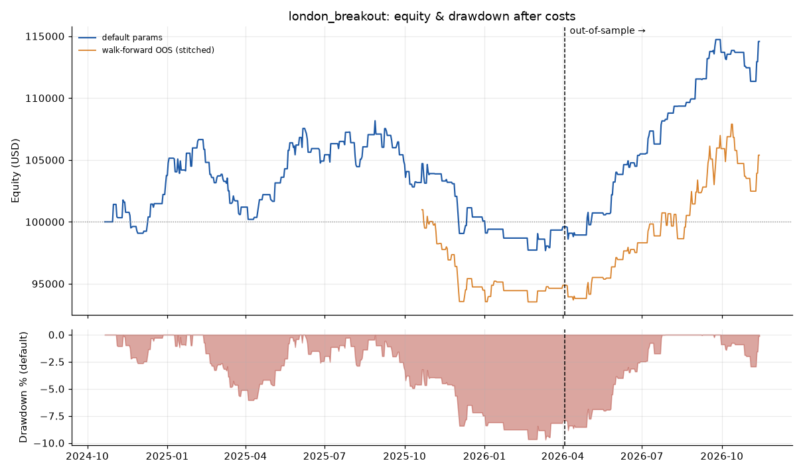

### Walk-forward folds

| Train | Test | Chosen params | Train exp. (R) | Test trades | Test exp. (R) | Test return |
|---|---|---|---:|---:|---:|---:|
| 2024-10-21 -> 2025-10-21 | 2025-10-21 -> 2026-01-20 | entry_hours=3, buffer_atr=0, stop_frac=1, target_r=1 | +0.076 | 33 | -0.154 | -4.9% |
| 2025-01-21 -> 2026-01-21 | 2026-01-21 -> 2026-04-20 | entry_hours=2, buffer_atr=0.05, stop_frac=1, target_r=1 | +0.056 | 11 | -0.129 | -1.4% |
| 2025-04-21 -> 2026-04-21 | 2026-04-21 -> 2026-07-20 | entry_hours=2, buffer_atr=0.05, stop_frac=1, target_r=1 | +0.061 | 20 | +0.272 | +5.4% |
| 2025-07-21 -> 2026-07-21 | 2026-07-21 -> 2026-10-20 | entry_hours=2, buffer_atr=0, stop_frac=0.5, target_r=1 | +0.082 | 37 | +0.161 | +5.9% |
| 2025-10-21 -> 2026-10-21 | 2026-10-21 -> 2026-11-13 | entry_hours=3, buffer_atr=0.1, stop_frac=1, target_r=1.5 | +0.187 | 5 | +0.158 | +0.6% |

### Parameter sensitivity

74% of 108 parameter combinations have positive full-period expectancy (combos with >= 20 trades). One parameter at a time, others at default (default in bold):

| Parameter | Value | Trades | Exp. (R) | PF |
|---|---:|---:|---:|---:|
| entry_hours | 2 | 170 | +0.083 | 1.32 |
| entry_hours | **3** | 211 | +0.068 | 1.26 |
| entry_hours | 4 | 233 | +0.058 | 1.22 |
| buffer_atr | 0 | 302 | +0.068 | 1.22 |
| buffer_atr | **0.05** | 211 | +0.068 | 1.26 |
| buffer_atr | 0.1 | 151 | +0.021 | 1.08 |
| stop_frac | 0.5 | 211 | +0.023 | 1.05 |
| stop_frac | 0.75 | 211 | +0.029 | 1.08 |
| stop_frac | **1** | 211 | +0.068 | 1.26 |
| target_r | 1 | 211 | +0.074 | 1.30 |
| target_r | **1.5** | 211 | +0.068 | 1.26 |
| target_r | 2 | 211 | +0.075 | 1.29 |
| target_r | 2.5 | 211 | +0.072 | 1.28 |

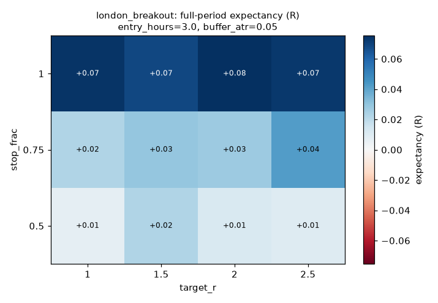

### Monthly returns (default parameters, full period)

| Year | Jan | Feb | Mar | Apr | May | Jun | Jul | Aug | Sep | Oct | Nov | Dec | Year |
|---|---:|---:|---:|---:|---:|---:|---:|---:|---:|---:|---:|---:|---:|
| 2024 | n/a | n/a | n/a | n/a | n/a | n/a | n/a | n/a | n/a | +1.4% | -2.3% | +4.7% | +3.7% |
| 2025 | +2.1% | -2.1% | -2.4% | +0.6% | +4.3% | -1.2% | +1.4% | +0.7% | -2.1% | -0.9% | -1.8% | -1.9% | -3.5% |
| 2026 | -1.4% | -1.0% | +1.7% | +1.4% | +2.4% | +2.2% | +3.1% | +1.1% | +3.4% | -1.1% | +1.9% | n/a | +14.5% |

## ny_momentum

**Verdict: IN-SAMPLE ONLY (does not survive out-of-sample)**

Why:

- walk-forward t-stat >= 2.0 (got 0.17)
- default params OOS expectancy > 0 (got -0.287R)
- OOS still positive at 2x costs (got -0.300R)
- >= 60% of parameter grid positive (got 24%)

Default parameters: `open_hour=8.5, obs_minutes=30, thresh_atr=0.15, stop_atr=0.25, target_r=2.0, flat_hour=16.0`  
In-sample optimised: `obs_minutes=45, thresh_atr=0.2, stop_atr=0.25, target_r=1`

| Period | Trades | Win rate | PF | Exp. (R) | t-stat | Return | Max DD | Longest losing streak |
|---|---:|---:|---:|---:|---:|---:|---:|---:|
| Full (default) | 116 | 37.1% | 0.86 | -0.080 | -0.73 | -9.5% | 21.5% | 9 |
| IS (default) | 81 | 39.5% | 1.00 | +0.009 | 0.06 | +0.2% | 11.8% | 8 |
| OOS (default) | 35 | 31.4% | 0.52 | -0.287 | -1.69 | -9.6% | 14.0% | 9 |
| OOS 2x costs | 35 | 31.4% | 0.50 | -0.300 | -1.80 | -9.9% | 14.2% | 9 |
| IS (optimised) | 77 | 61.0% | 1.47 | +0.179 | 1.73 | +14.3% | 5.2% | 3 |
| OOS (optimised) | 27 | 29.6% | 0.46 | -0.325 | -1.90 | -8.4% | 11.7% | 10 |
| Walk-forward OOS | 67 | 46.3% | 1.04 | +0.021 | 0.17 | +1.2% | 7.8% | 6 |

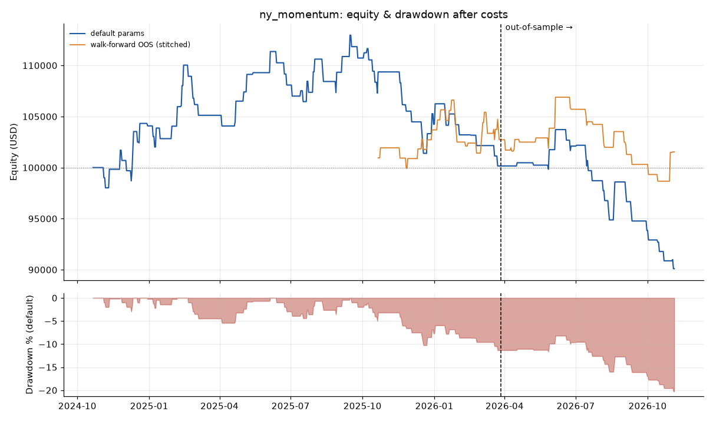

### Walk-forward folds

| Train | Test | Chosen params | Train exp. (R) | Test trades | Test exp. (R) | Test return |
|---|---|---|---:|---:|---:|---:|
| 2024-10-21 -> 2025-10-21 | 2025-10-21 -> 2026-01-20 | obs_minutes=45, thresh_atr=0.2, stop_atr=0.25, target_r=1 | +0.202 | 14 | +0.397 | +5.6% |
| 2025-01-21 -> 2026-01-21 | 2026-01-21 -> 2026-04-20 | obs_minutes=60, thresh_atr=0.1, stop_atr=0.35, target_r=1 | +0.125 | 27 | -0.113 | -2.9% |
| 2025-04-21 -> 2026-04-21 | 2026-04-21 -> 2026-07-20 | obs_minutes=45, thresh_atr=0.2, stop_atr=0.35, target_r=3 | +0.202 | 11 | +0.184 | +1.9% |
| 2025-07-21 -> 2026-07-21 | 2026-07-21 -> 2026-10-20 | obs_minutes=45, thresh_atr=0.2, stop_atr=0.35, target_r=3 | +0.267 | 11 | -0.528 | -5.6% |
| 2025-10-21 -> 2026-10-21 | 2026-10-21 -> 2026-11-13 | obs_minutes=45, thresh_atr=0.2, stop_atr=0.35, target_r=3 | +0.038 | 4 | +0.665 | +2.6% |

### Parameter sensitivity

24% of 144 parameter combinations have positive full-period expectancy (combos with >= 20 trades). One parameter at a time, others at default (default in bold):

| Parameter | Value | Trades | Exp. (R) | PF |
|---|---:|---:|---:|---:|
| obs_minutes | 15 | 72 | -0.273 | 0.59 |
| obs_minutes | **30** | 116 | -0.080 | 0.86 |
| obs_minutes | 45 | 156 | +0.012 | 1.02 |
| obs_minutes | 60 | 171 | -0.024 | 0.95 |
| thresh_atr | 0.1 | 207 | -0.046 | 0.91 |
| thresh_atr | **0.15** | 116 | -0.080 | 0.86 |
| thresh_atr | 0.2 | 62 | -0.047 | 0.92 |
| stop_atr | 0.15 | 116 | -0.134 | 0.80 |
| stop_atr | **0.25** | 116 | -0.080 | 0.86 |
| stop_atr | 0.35 | 116 | -0.072 | 0.84 |
| target_r | 1 | 116 | -0.032 | 0.93 |
| target_r | 1.5 | 116 | -0.087 | 0.84 |
| target_r | **2** | 116 | -0.080 | 0.86 |
| target_r | 3 | 116 | -0.063 | 0.89 |

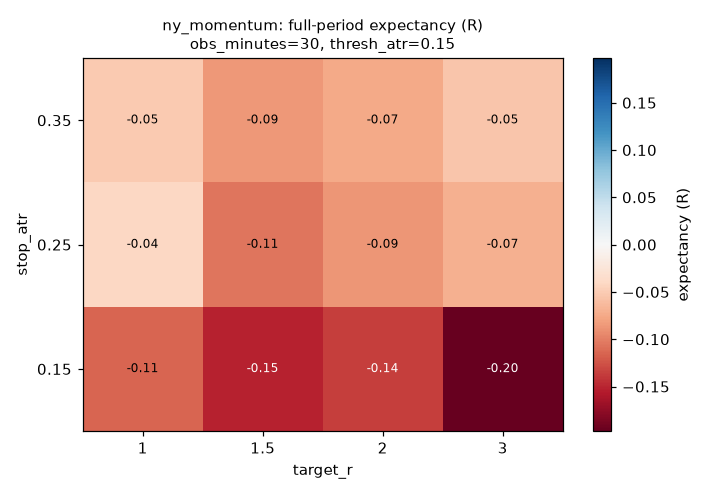

### Monthly returns (default parameters, full period)

| Year | Jan | Feb | Mar | Apr | May | Jun | Jul | Aug | Sep | Oct | Nov | Dec | Year |
|---|---:|---:|---:|---:|---:|---:|---:|---:|---:|---:|---:|---:|---:|
| 2024 | n/a | n/a | n/a | n/a | n/a | n/a | n/a | n/a | n/a | +0.0% | +0.7% | +3.4% | +4.1% |
| 2025 | -0.0% | +2.0% | -1.0% | +1.3% | +2.6% | -1.1% | +1.2% | -0.0% | +1.3% | -1.2% | -3.5% | -1.2% | +0.2% |
| 2026 | -0.0% | -2.0% | -2.0% | +0.3% | +1.3% | +0.3% | -3.3% | -0.1% | -4.8% | -3.2% | -0.4% | n/a | -13.1% |

## vwap_fade

**Verdict: NO EDGE (loses even in-sample after costs)**

Why:

- walk-forward expectancy > 0 (got -0.013R)
- walk-forward t-stat >= 2.0 (got -0.08)
- default params OOS expectancy > 0 (got -0.038R)
- OOS still positive at 2x costs (got -0.056R)
- >= 60% of parameter grid positive (got 0%)

Default parameters: `dev_atr=0.35, stop_atr=0.25, start_hour=10.0, end_hour=14.0, flat_hour=16.0, min_reward_risk=0.8`  
In-sample optimised: `dev_atr=0.55, stop_atr=0.15, min_reward_risk=0.5`

| Period | Trades | Win rate | PF | Exp. (R) | t-stat | Return | Max DD | Longest losing streak |
|---|---:|---:|---:|---:|---:|---:|---:|---:|
| Full (default) | 261 | 39.8% | 0.79 | -0.094 | -1.41 | -22.8% | 29.3% | 11 |
| IS (default) | 193 | 37.3% | 0.75 | -0.114 | -1.43 | -20.6% | 29.3% | 11 |
| OOS (default) | 68 | 47.1% | 0.91 | -0.038 | -0.32 | -2.8% | 9.1% | 7 |
| OOS 2x costs | 68 | 47.1% | 0.86 | -0.056 | -0.48 | -4.1% | 9.8% | 7 |
| IS (optimised) | 94 | 28.7% | 0.95 | -0.011 | -0.06 | -2.9% | 22.6% | 19 |
| OOS (optimised) | 28 | 35.7% | 0.77 | -0.140 | -0.57 | -4.1% | 10.8% | 6 |
| Walk-forward OOS | 67 | 43.3% | 0.95 | -0.013 | -0.08 | -1.5% | 11.7% | 6 |

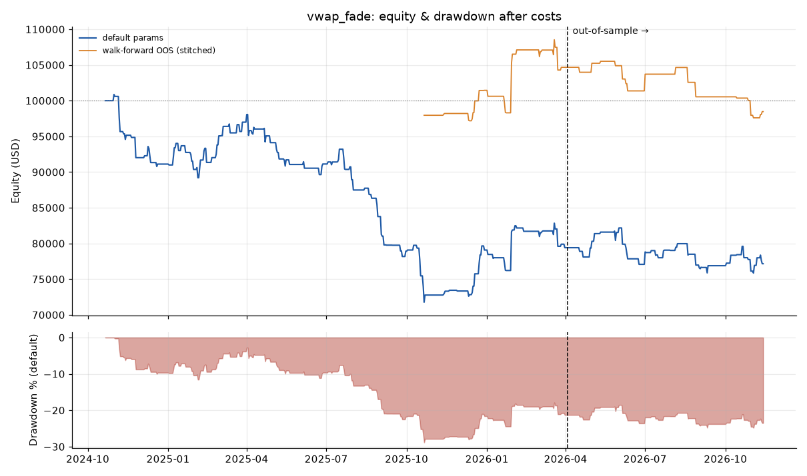

### Walk-forward folds

| Train | Test | Chosen params | Train exp. (R) | Test trades | Test exp. (R) | Test return |
|---|---|---|---:|---:|---:|---:|
| 2024-10-21 -> 2025-10-21 | 2025-10-21 -> 2026-01-20 | dev_atr=0.45, stop_atr=0.35, min_reward_risk=0.5 | -0.170 | 18 | +0.035 | +0.6% |
| 2025-01-21 -> 2026-01-21 | 2026-01-21 -> 2026-04-20 | dev_atr=0.45, stop_atr=0.25, min_reward_risk=0.5 | -0.098 | 23 | +0.168 | +3.3% |
| 2025-04-21 -> 2026-04-21 | 2026-04-21 -> 2026-07-20 | dev_atr=0.55, stop_atr=0.25, min_reward_risk=0.5 | +0.070 | 10 | -0.021 | -0.3% |
| 2025-07-21 -> 2026-07-21 | 2026-07-21 -> 2026-10-20 | dev_atr=0.55, stop_atr=0.15, min_reward_risk=0.5 | +0.045 | 8 | -0.408 | -3.2% |
| 2025-10-21 -> 2026-10-21 | 2026-10-21 -> 2026-11-13 | dev_atr=0.55, stop_atr=0.25, min_reward_risk=0.5 | +0.254 | 8 | -0.237 | -1.9% |

### Parameter sensitivity

0% of 60 parameter combinations have positive full-period expectancy (combos with >= 20 trades). One parameter at a time, others at default (default in bold):

| Parameter | Value | Trades | Exp. (R) | PF |
|---|---:|---:|---:|---:|
| dev_atr | 0.25 | 423 | -0.108 | 0.77 |
| dev_atr | 0.3 | 333 | -0.090 | 0.81 |
| dev_atr | **0.35** | 261 | -0.094 | 0.81 |
| dev_atr | 0.45 | 159 | -0.093 | 0.81 |
| dev_atr | 0.55 | 108 | -0.084 | 0.84 |
| stop_atr | 0.15 | 303 | -0.077 | 0.87 |
| stop_atr | 0.2 | 278 | -0.104 | 0.81 |
| stop_atr | **0.25** | 261 | -0.094 | 0.81 |
| stop_atr | 0.35 | 234 | -0.063 | 0.83 |
| min_reward_risk | 0.5 | 261 | -0.094 | 0.81 |
| min_reward_risk | **0.8** | 261 | -0.094 | 0.81 |
| min_reward_risk | 1.2 | 261 | -0.094 | 0.81 |

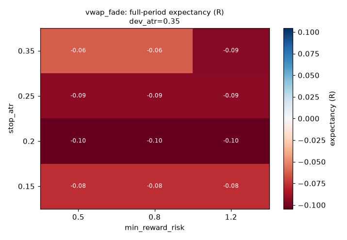

### Monthly returns (default parameters, full period)

| Year | Jan | Feb | Mar | Apr | May | Jun | Jul | Aug | Sep | Oct | Nov | Dec | Year |
|---|---:|---:|---:|---:|---:|---:|---:|---:|---:|---:|---:|---:|---:|
| 2024 | n/a | n/a | n/a | n/a | n/a | n/a | n/a | n/a | n/a | +0.9% | -8.8% | -1.0% | -8.9% |
| 2025 | -0.8% | +5.2% | +2.0% | -3.0% | -3.2% | +0.1% | -2.4% | -5.8% | -5.8% | -7.8% | +0.8% | +7.8% | -13.2% |
| 2026 | +3.5% | -0.2% | -2.8% | -0.1% | +2.8% | -5.5% | +2.5% | -2.6% | -0.1% | -1.0% | +1.4% | n/a | -2.4% |

## lb_trend

**Verdict: INCONCLUSIVE (positive out-of-sample, but not convincing)**

Why:

- walk-forward t-stat >= 2.0 (got 0.89)

Default parameters: `entry_hours=3.0, buffer_atr=0.05, stop_frac=1.0, target_r=1.5, min_range_atr=0.15, max_range_atr=0.8, flat_hour=16.0, trend_days=20, confirm_close=False`  
In-sample optimised: `entry_hours=3, buffer_atr=0, stop_frac=1, target_r=2.5`

| Period | Trades | Win rate | PF | Exp. (R) | t-stat | Return | Max DD | Longest losing streak |
|---|---:|---:|---:|---:|---:|---:|---:|---:|
| Full (default) | 104 | 52.9% | 1.39 | +0.093 | 1.33 | +9.8% | 5.3% | 5 |
| IS (default) | 70 | 44.3% | 1.05 | +0.017 | 0.20 | +1.1% | 5.3% | 5 |
| OOS (default) | 34 | 70.6% | 2.60 | +0.249 | 2.12 | +8.5% | 2.4% | 3 |
| OOS 2x costs | 34 | 70.6% | 2.52 | +0.237 | 2.04 | +8.1% | 2.4% | 3 |
| IS (optimised) | 104 | 51.0% | 1.29 | +0.095 | 1.06 | +9.8% | 7.5% | 6 |
| OOS (optimised) | 48 | 60.4% | 1.54 | +0.161 | 1.28 | +7.7% | 5.1% | 6 |
| Walk-forward OOS | 52 | 55.8% | 1.34 | +0.100 | 0.89 | +5.0% | 4.2% | 5 |

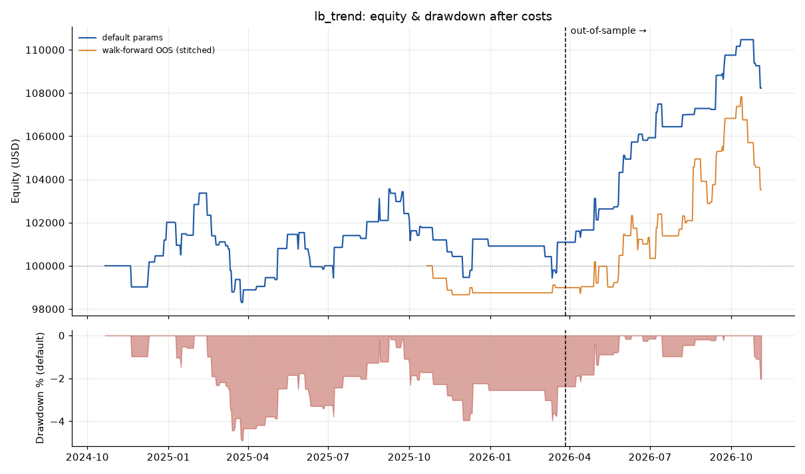

### Walk-forward folds

| Train | Test | Chosen params | Train exp. (R) | Test trades | Test exp. (R) | Test return |
|---|---|---|---:|---:|---:|---:|
| 2024-10-21 -> 2025-10-21 | 2025-10-21 -> 2026-01-20 | entry_hours=2, buffer_atr=0.05, stop_frac=1, target_r=2.5 | +0.096 | 5 | -0.251 | -1.3% |
| 2025-01-21 -> 2026-01-21 | 2026-01-21 -> 2026-04-20 | entry_hours=2, buffer_atr=0.05, stop_frac=1, target_r=2 | +0.097 | 4 | +0.075 | +0.3% |
| 2025-04-21 -> 2026-04-21 | 2026-04-21 -> 2026-07-20 | entry_hours=3, buffer_atr=0, stop_frac=1, target_r=2.5 | +0.133 | 19 | +0.128 | +2.4% |
| 2025-07-21 -> 2026-07-21 | 2026-07-21 -> 2026-10-20 | entry_hours=3, buffer_atr=0, stop_frac=1, target_r=2.5 | +0.170 | 20 | +0.217 | +4.3% |
| 2025-10-21 -> 2026-10-21 | 2026-10-21 -> 2026-11-13 | entry_hours=2, buffer_atr=0.05, stop_frac=1, target_r=1.5 | +0.277 | 4 | -0.159 | -0.7% |

### Parameter sensitivity

83% of 108 parameter combinations have positive full-period expectancy (combos with >= 20 trades). One parameter at a time, others at default (default in bold):

| Parameter | Value | Trades | Exp. (R) | PF |
|---|---:|---:|---:|---:|
| entry_hours | 2 | 82 | +0.136 | 1.58 |
| entry_hours | **3** | 104 | +0.093 | 1.39 |
| entry_hours | 4 | 116 | +0.080 | 1.31 |
| buffer_atr | 0 | 152 | +0.095 | 1.31 |
| buffer_atr | **0.05** | 104 | +0.093 | 1.39 |
| buffer_atr | 0.1 | 76 | +0.062 | 1.26 |
| stop_frac | 0.5 | 104 | -0.005 | 0.99 |
| stop_frac | 0.75 | 104 | +0.065 | 1.19 |
| stop_frac | **1** | 104 | +0.093 | 1.39 |
| target_r | 1 | 104 | +0.075 | 1.31 |
| target_r | **1.5** | 104 | +0.093 | 1.39 |
| target_r | 2 | 104 | +0.098 | 1.41 |
| target_r | 2.5 | 104 | +0.084 | 1.35 |

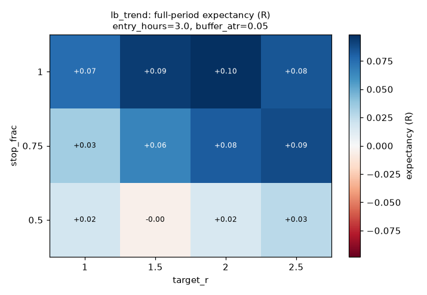

### Monthly returns (default parameters, full period)

| Year | Jan | Feb | Mar | Apr | May | Jun | Jul | Aug | Sep | Oct | Nov | Dec | Year |
|---|---:|---:|---:|---:|---:|---:|---:|---:|---:|---:|---:|---:|---:|
| 2024 | n/a | n/a | n/a | n/a | n/a | n/a | n/a | n/a | n/a | +0.0% | -1.0% | +3.0% | +2.0% |
| 2025 | +0.8% | -1.7% | -2.2% | +0.6% | +2.1% | -1.5% | +1.4% | +0.7% | +0.3% | -1.2% | -0.8% | +0.5% | -1.1% |
| 2026 | +0.0% | +0.0% | +0.2% | +2.0% | +1.2% | +1.5% | +0.5% | +0.8% | +2.3% | -0.4% | +0.5% | n/a | +8.8% |

## lb_confirm

**Verdict: NO EDGE (loses even in-sample after costs)**

Why:

- walk-forward expectancy > 0 (got -0.075R)
- walk-forward t-stat >= 2.0 (got -0.65)
- >= 60% of parameter grid positive (got 41%)

Default parameters: `entry_hours=3.0, buffer_atr=0.05, stop_frac=1.0, target_r=1.5, min_range_atr=0.15, max_range_atr=0.8, flat_hour=16.0, trend_days=0, confirm_close=True`  
In-sample optimised: `entry_hours=3, buffer_atr=0.1, stop_frac=1, target_r=2.5`

| Period | Trades | Win rate | PF | Exp. (R) | t-stat | Return | Max DD | Longest losing streak |
|---|---:|---:|---:|---:|---:|---:|---:|---:|
| Full (default) | 163 | 49.1% | 1.01 | +0.007 | 0.13 | +0.5% | 15.0% | 8 |
| IS (default) | 116 | 44.0% | 0.76 | -0.082 | -1.18 | -9.4% | 15.0% | 8 |
| OOS (default) | 47 | 61.7% | 2.31 | +0.227 | 2.27 | +10.8% | 3.0% | 3 |
| OOS 2x costs | 47 | 61.7% | 2.23 | +0.215 | 2.17 | +10.3% | 3.0% | 3 |
| IS (optimised) | 92 | 46.7% | 0.97 | -0.005 | -0.06 | -0.7% | 9.3% | 6 |
| OOS (optimised) | 32 | 59.4% | 1.86 | +0.140 | 1.31 | +4.4% | 2.5% | 4 |
| Walk-forward OOS | 68 | 45.6% | 0.81 | -0.075 | -0.65 | -5.3% | 18.1% | 10 |

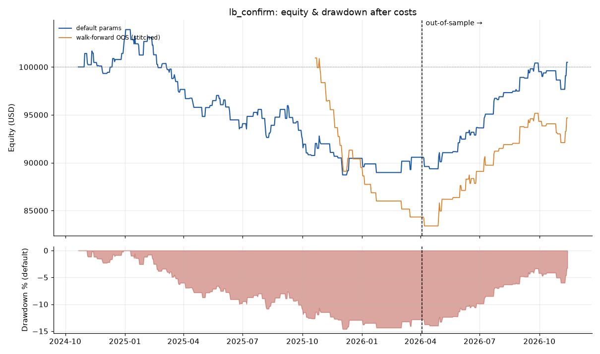

### Walk-forward folds

| Train | Test | Chosen params | Train exp. (R) | Test trades | Test exp. (R) | Test return |
|---|---|---|---:|---:|---:|---:|
| 2024-10-21 -> 2025-10-21 | 2025-10-21 -> 2026-01-20 | entry_hours=3, buffer_atr=0, stop_frac=0.5, target_r=1 | +0.027 | 26 | -0.542 | -13.1% |
| 2025-01-21 -> 2026-01-21 | 2026-01-21 -> 2026-04-20 | entry_hours=2, buffer_atr=0.05, stop_frac=0.5, target_r=1.5 | -0.042 | 5 | -0.827 | -4.0% |
| 2025-04-21 -> 2026-04-21 | 2026-04-21 -> 2026-07-20 | entry_hours=2, buffer_atr=0.05, stop_frac=0.5, target_r=1.5 | +0.024 | 16 | +0.470 | +7.6% |
| 2025-07-21 -> 2026-07-21 | 2026-07-21 -> 2026-10-20 | entry_hours=2, buffer_atr=0.05, stop_frac=1, target_r=2 | +0.039 | 16 | +0.305 | +4.8% |
| 2025-10-21 -> 2026-10-21 | 2026-10-21 -> 2026-11-13 | entry_hours=4, buffer_atr=0.05, stop_frac=1, target_r=2 | +0.183 | 5 | +0.151 | +0.7% |

### Parameter sensitivity

41% of 108 parameter combinations have positive full-period expectancy (combos with >= 20 trades). One parameter at a time, others at default (default in bold):

| Parameter | Value | Trades | Exp. (R) | PF |
|---|---:|---:|---:|---:|
| entry_hours | 2 | 133 | +0.033 | 1.12 |
| entry_hours | **3** | 163 | +0.007 | 1.02 |
| entry_hours | 4 | 189 | +0.024 | 1.09 |
| buffer_atr | 0 | 234 | -0.011 | 0.97 |
| buffer_atr | **0.05** | 163 | +0.007 | 1.02 |
| buffer_atr | 0.1 | 124 | +0.027 | 1.10 |
| stop_frac | 0.5 | 163 | -0.013 | 0.97 |
| stop_frac | 0.75 | 163 | -0.033 | 0.92 |
| stop_frac | **1** | 163 | +0.007 | 1.02 |
| target_r | 1 | 163 | -0.008 | 0.97 |
| target_r | **1.5** | 163 | +0.007 | 1.02 |
| target_r | 2 | 163 | +0.029 | 1.10 |
| target_r | 2.5 | 163 | +0.025 | 1.08 |

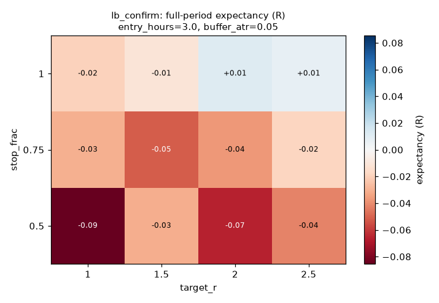

### Monthly returns (default parameters, full period)

| Year | Jan | Feb | Mar | Apr | May | Jun | Jul | Aug | Sep | Oct | Nov | Dec | Year |
|---|---:|---:|---:|---:|---:|---:|---:|---:|---:|---:|---:|---:|---:|
| 2024 | n/a | n/a | n/a | n/a | n/a | n/a | n/a | n/a | n/a | +1.4% | -2.1% | +3.6% | +2.9% |
| 2025 | -0.2% | -2.3% | -2.7% | -2.9% | +1.3% | -2.5% | +1.0% | +1.0% | -3.0% | -0.8% | -1.6% | -0.0% | -12.1% |
| 2026 | -1.6% | +0.0% | +1.8% | +0.5% | +1.1% | +1.7% | +3.5% | +0.6% | +2.1% | -0.9% | +1.9% | n/a | +11.1% |

## lb_early_exit

**Verdict: INCONCLUSIVE (positive out-of-sample, but not convincing)**

Why:

- walk-forward t-stat >= 2.0 (got 0.56)
- >= 60% of parameter grid positive (got 41%)

Default parameters: `entry_hours=3.0, buffer_atr=0.05, stop_frac=1.0, target_r=1.5, min_range_atr=0.15, max_range_atr=0.8, flat_hour=13.0, trend_days=0, confirm_close=False`  
In-sample optimised: `entry_hours=2, buffer_atr=0, stop_frac=1, target_r=1`

| Period | Trades | Win rate | PF | Exp. (R) | t-stat | Return | Max DD | Longest losing streak |
|---|---:|---:|---:|---:|---:|---:|---:|---:|
| Full (default) | 211 | 48.8% | 1.03 | +0.007 | 0.21 | +1.1% | 6.6% | 9 |
| IS (default) | 151 | 49.0% | 0.94 | -0.009 | -0.24 | -1.6% | 6.6% | 9 |
| OOS (default) | 60 | 48.3% | 1.36 | +0.046 | 0.91 | +2.7% | 2.6% | 6 |
| OOS 2x costs | 60 | 48.3% | 1.27 | +0.036 | 0.72 | +2.1% | 2.7% | 6 |
| IS (optimised) | 190 | 48.9% | 1.11 | +0.023 | 0.61 | +4.1% | 5.1% | 7 |
| OOS (optimised) | 83 | 51.8% | 1.30 | +0.048 | 0.92 | +3.9% | 3.2% | 5 |
| Walk-forward OOS | 106 | 49.1% | 1.15 | +0.025 | 0.56 | +2.6% | 3.6% | 7 |

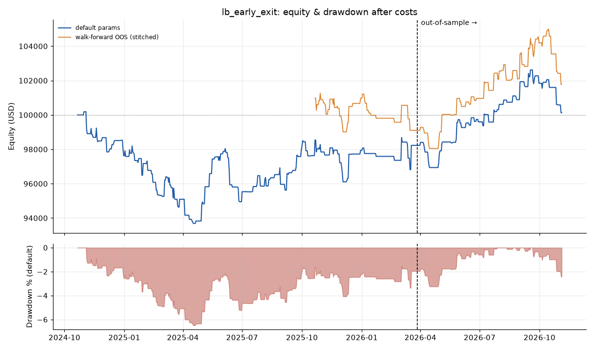

### Walk-forward folds

| Train | Test | Chosen params | Train exp. (R) | Test trades | Test exp. (R) | Test return |
|---|---|---|---:|---:|---:|---:|
| 2024-10-21 -> 2025-10-21 | 2025-10-21 -> 2026-01-20 | entry_hours=3, buffer_atr=0, stop_frac=1, target_r=1 | +0.033 | 33 | -0.001 | -0.0% |
| 2025-01-21 -> 2026-01-21 | 2026-01-21 -> 2026-04-20 | entry_hours=2, buffer_atr=0.05, stop_frac=1, target_r=1 | +0.060 | 11 | -0.188 | -1.9% |
| 2025-04-21 -> 2026-04-21 | 2026-04-21 -> 2026-07-20 | entry_hours=2, buffer_atr=0.05, stop_frac=1, target_r=1 | +0.088 | 20 | +0.175 | +3.4% |
| 2025-07-21 -> 2026-07-21 | 2026-07-21 -> 2026-10-20 | entry_hours=2, buffer_atr=0, stop_frac=1, target_r=1.5 | +0.068 | 37 | +0.058 | +2.1% |
| 2025-10-21 -> 2026-10-21 | 2026-10-21 -> 2026-11-13 | entry_hours=2, buffer_atr=0.1, stop_frac=0.75, target_r=1 | +0.145 | 5 | -0.178 | -0.9% |

### Parameter sensitivity

41% of 108 parameter combinations have positive full-period expectancy (combos with >= 20 trades). One parameter at a time, others at default (default in bold):

| Parameter | Value | Trades | Exp. (R) | PF |
|---|---:|---:|---:|---:|
| entry_hours | 2 | 170 | +0.012 | 1.07 |
| entry_hours | **3** | 211 | +0.007 | 1.04 |
| entry_hours | 4 | 233 | +0.005 | 1.03 |
| buffer_atr | 0 | 302 | +0.012 | 1.07 |
| buffer_atr | **0.05** | 211 | +0.007 | 1.04 |
| buffer_atr | 0.1 | 151 | -0.026 | 0.85 |
| stop_frac | 0.5 | 211 | -0.003 | 0.99 |
| stop_frac | 0.75 | 211 | +0.008 | 1.03 |
| stop_frac | **1** | 211 | +0.007 | 1.04 |
| target_r | 1 | 211 | +0.022 | 1.14 |
| target_r | **1.5** | 211 | +0.007 | 1.04 |
| target_r | 2 | 211 | +0.010 | 1.06 |
| target_r | 2.5 | 211 | +0.004 | 1.03 |

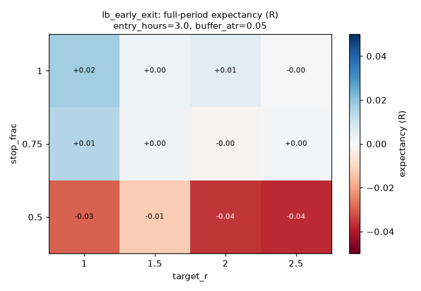

### Monthly returns (default parameters, full period)

| Year | Jan | Feb | Mar | Apr | May | Jun | Jul | Aug | Sep | Oct | Nov | Dec | Year |
|---|---:|---:|---:|---:|---:|---:|---:|---:|---:|---:|---:|---:|---:|
| 2024 | n/a | n/a | n/a | n/a | n/a | n/a | n/a | n/a | n/a | +0.2% | -1.5% | -1.1% | -2.4% |
| 2025 | -0.5% | -2.0% | -0.2% | -0.3% | +3.1% | -2.8% | +1.0% | +0.1% | +2.1% | -0.1% | -0.6% | +0.7% | +0.3% |
| 2026 | -0.4% | -0.2% | +0.9% | -0.5% | +2.0% | -0.1% | +1.0% | +0.3% | +0.9% | -1.2% | +0.5% | n/a | +3.2% |

## lb_tight_range

**Verdict: INCONCLUSIVE (positive out-of-sample, but not convincing)**

Why:

- walk-forward t-stat >= 2.0 (got 0.58)

Default parameters: `entry_hours=3.0, buffer_atr=0.05, stop_frac=1.0, target_r=1.5, min_range_atr=0.15, max_range_atr=0.5, flat_hour=16.0, trend_days=0, confirm_close=False`  
In-sample optimised: `entry_hours=2, buffer_atr=0.05, stop_frac=1, target_r=1`

| Period | Trades | Win rate | PF | Exp. (R) | t-stat | Return | Max DD | Longest losing streak |
|---|---:|---:|---:|---:|---:|---:|---:|---:|
| Full (default) | 156 | 51.9% | 1.30 | +0.086 | 1.37 | +13.4% | 9.2% | 6 |
| IS (default) | 112 | 43.8% | 0.98 | -0.002 | -0.03 | -0.6% | 9.2% | 6 |
| OOS (default) | 44 | 72.7% | 3.06 | +0.313 | 2.86 | +14.2% | 2.4% | 2 |
| OOS 2x costs | 44 | 72.7% | 2.95 | +0.299 | 2.76 | +13.6% | 2.4% | 2 |
| IS (optimised) | 91 | 49.5% | 1.15 | +0.050 | 0.64 | +4.3% | 5.5% | 4 |
| OOS (optimised) | 36 | 66.7% | 2.35 | +0.246 | 2.19 | +9.0% | 2.3% | 3 |
| Walk-forward OOS | 74 | 52.7% | 1.16 | +0.056 | 0.58 | +3.9% | 8.1% | 6 |

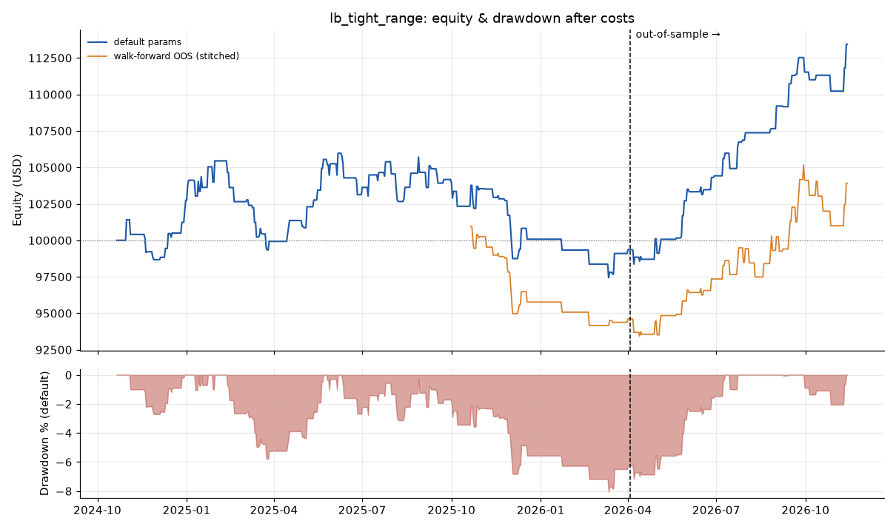

### Walk-forward folds

| Train | Test | Chosen params | Train exp. (R) | Test trades | Test exp. (R) | Test return |
|---|---|---|---:|---:|---:|---:|
| 2024-10-21 -> 2025-10-21 | 2025-10-21 -> 2026-01-20 | entry_hours=4, buffer_atr=0.05, stop_frac=1, target_r=1 | +0.090 | 20 | -0.218 | -4.2% |
| 2025-01-21 -> 2026-01-21 | 2026-01-21 -> 2026-04-20 | entry_hours=2, buffer_atr=0.05, stop_frac=1, target_r=1 | +0.073 | 10 | -0.241 | -2.3% |
| 2025-04-21 -> 2026-04-21 | 2026-04-21 -> 2026-07-20 | entry_hours=2, buffer_atr=0.05, stop_frac=1, target_r=1 | +0.052 | 15 | +0.298 | +4.4% |
| 2025-07-21 -> 2026-07-21 | 2026-07-21 -> 2026-10-20 | entry_hours=2, buffer_atr=0, stop_frac=0.5, target_r=1 | +0.131 | 26 | +0.172 | +4.5% |
| 2025-10-21 -> 2026-10-21 | 2026-10-21 -> 2026-11-13 | entry_hours=3, buffer_atr=0.1, stop_frac=1, target_r=1.5 | +0.203 | 3 | +0.652 | +1.9% |

### Parameter sensitivity

80% of 108 parameter combinations have positive full-period expectancy (combos with >= 20 trades). One parameter at a time, others at default (default in bold):

| Parameter | Value | Trades | Exp. (R) | PF |
|---|---:|---:|---:|---:|
| entry_hours | 2 | 127 | +0.102 | 1.36 |
| entry_hours | **3** | 156 | +0.086 | 1.30 |
| entry_hours | 4 | 171 | +0.077 | 1.27 |
| buffer_atr | 0 | 224 | +0.061 | 1.17 |
| buffer_atr | **0.05** | 156 | +0.086 | 1.30 |
| buffer_atr | 0.1 | 110 | +0.042 | 1.15 |
| stop_frac | 0.5 | 156 | +0.048 | 1.11 |
| stop_frac | 0.75 | 156 | +0.041 | 1.10 |
| stop_frac | **1** | 156 | +0.086 | 1.30 |
| target_r | 1 | 156 | +0.087 | 1.32 |
| target_r | **1.5** | 156 | +0.086 | 1.30 |
| target_r | 2 | 156 | +0.090 | 1.32 |
| target_r | 2.5 | 156 | +0.081 | 1.28 |

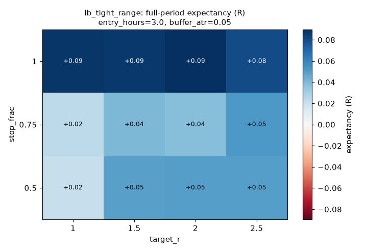

### Monthly returns (default parameters, full period)

| Year | Jan | Feb | Mar | Apr | May | Jun | Jul | Aug | Sep | Oct | Nov | Dec | Year |
|---|---:|---:|---:|---:|---:|---:|---:|---:|---:|---:|---:|---:|---:|
| 2024 | n/a | n/a | n/a | n/a | n/a | n/a | n/a | n/a | n/a | +1.4% | -2.7% | +4.1% | +2.7% |
| 2025 | +2.6% | -2.7% | -2.7% | +1.0% | +4.3% | -2.0% | +1.4% | +0.1% | -0.5% | -0.6% | -1.8% | -1.6% | -2.6% |
| 2026 | -0.7% | -1.0% | +0.7% | +1.0% | +2.6% | +1.7% | +2.8% | +0.3% | +3.6% | -1.2% | +2.9% | n/a | +13.4% |

## regime_switch

**Verdict: NO EDGE (loses even in-sample after costs)**

Why:

- walk-forward expectancy > 0 (got -0.026R)
- walk-forward t-stat >= 2.0 (got -0.19)
- default params OOS expectancy > 0 (got -0.004R)
- OOS still positive at 2x costs (got -0.018R)
- >= 60% of parameter grid positive (got 0%)

Default parameters: `entry_hours=3.0, fade_min_rr=1.0, target_r=1.5, trend_atr=1.0, trend_days=20, chaos_atr=2.0, buffer_atr=0.05, stop_frac=1.0, min_range_atr=0.15, max_range_atr=0.8, flat_hour=16.0`  
In-sample optimised: `entry_hours=4, fade_min_rr=1, target_r=2, trend_atr=0.5`

| Period | Trades | Win rate | PF | Exp. (R) | t-stat | Return | Max DD | Longest losing streak |
|---|---:|---:|---:|---:|---:|---:|---:|---:|
| Full (default) | 97 | 35.1% | 0.50 | -0.245 | -2.62 | -21.4% | 23.0% | 10 |
| IS (default) | 72 | 27.8% | 0.41 | -0.328 | -3.05 | -21.2% | 23.0% | 10 |
| OOS (default) | 25 | 56.0% | 0.98 | -0.004 | -0.02 | -0.2% | 5.2% | 4 |
| OOS 2x costs | 25 | 56.0% | 0.93 | -0.018 | -0.10 | -0.6% | 5.1% | 4 |
| IS (optimised) | 70 | 40.0% | 0.89 | -0.041 | -0.33 | -3.2% | 12.7% | 5 |
| OOS (optimised) | 40 | 52.5% | 1.11 | +0.047 | 0.31 | +1.6% | 7.2% | 7 |
| Walk-forward OOS | 49 | 46.9% | 0.92 | -0.026 | -0.19 | -1.5% | 7.2% | 7 |

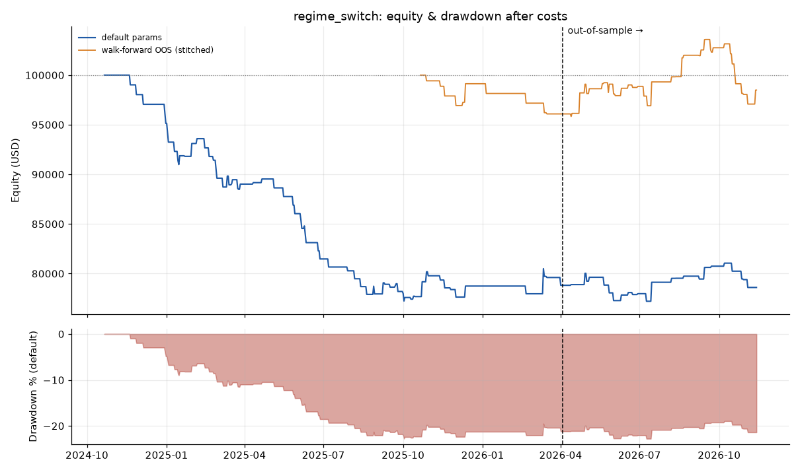

### Trades by setup (default parameters, full period)

| Setup | Trades | Win rate | Exp. (R) |
|---|---:|---:|---:|
| range_fade_long | 25 | 16.0% | -0.477 |
| range_fade_short | 21 | 19.0% | -0.526 |
| trend_long_break | 38 | 47.4% | -0.041 |
| trend_short_break | 13 | 61.5% | +0.061 |

### Walk-forward folds

| Train | Test | Chosen params | Train exp. (R) | Test trades | Test exp. (R) | Test return |
|---|---|---|---:|---:|---:|---:|
| 2024-10-21 -> 2025-10-21 | 2025-10-21 -> 2026-01-20 | entry_hours=4, fade_min_rr=1, target_r=2, trend_atr=0.5 | -0.116 | 7 | -0.262 | -1.8% |
| 2025-01-21 -> 2026-01-21 | 2026-01-21 -> 2026-04-20 | entry_hours=2, fade_min_rr=1, target_r=2, trend_atr=0.5 | -0.094 | 5 | -0.418 | -2.0% |
| 2025-04-21 -> 2026-04-21 | 2026-04-21 -> 2026-07-20 | entry_hours=4, fade_min_rr=0.5, target_r=2, trend_atr=0.5 | -0.059 | 17 | +0.198 | +3.3% |
| 2025-07-21 -> 2026-07-21 | 2026-07-21 -> 2026-10-20 | entry_hours=4, fade_min_rr=1.5, target_r=2, trend_atr=0.5 | +0.160 | 16 | -0.005 | -0.2% |
| 2025-10-21 -> 2026-10-21 | 2026-10-21 -> 2026-11-13 | entry_hours=3, fade_min_rr=0.5, target_r=1.5, trend_atr=0.5 | +0.229 | 4 | -0.159 | -0.6% |

### Parameter sensitivity

0% of 81 parameter combinations have positive full-period expectancy (combos with >= 20 trades). One parameter at a time, others at default (default in bold):

| Parameter | Value | Trades | Exp. (R) | PF |
|---|---:|---:|---:|---:|
| entry_hours | 2 | 74 | -0.252 | 0.53 |
| entry_hours | **3** | 97 | -0.245 | 0.53 |
| entry_hours | 4 | 118 | -0.185 | 0.66 |
| fade_min_rr | 0.5 | 102 | -0.249 | 0.52 |
| fade_min_rr | **1** | 97 | -0.245 | 0.53 |
| fade_min_rr | 1.5 | 91 | -0.247 | 0.53 |
| target_r | 1 | 97 | -0.249 | 0.52 |
| target_r | **1.5** | 97 | -0.245 | 0.53 |
| target_r | 2 | 97 | -0.240 | 0.54 |
| trend_atr | 0.5 | 90 | -0.025 | 0.93 |
| trend_atr | **1** | 97 | -0.245 | 0.53 |
| trend_atr | 1.5 | 92 | -0.234 | 0.58 |

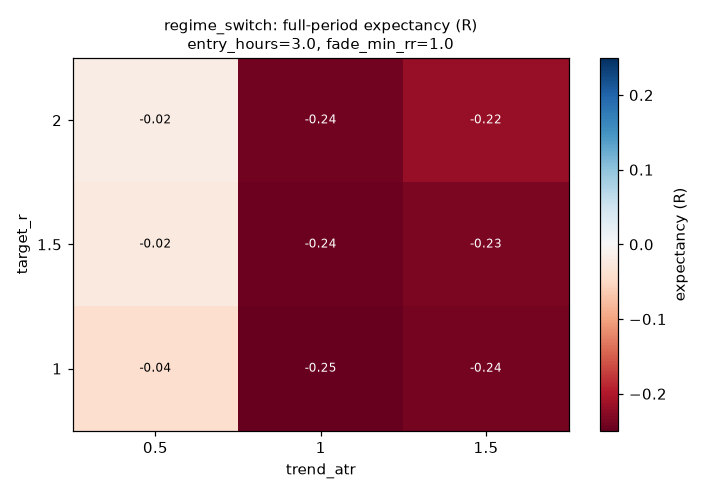

### Monthly returns (default parameters, full period)

| Year | Jan | Feb | Mar | Apr | May | Jun | Jul | Aug | Sep | Oct | Nov | Dec | Year |
|---|---:|---:|---:|---:|---:|---:|---:|---:|---:|---:|---:|---:|---:|
| 2024 | n/a | n/a | n/a | n/a | n/a | n/a | n/a | n/a | n/a | +0.0% | -2.0% | -3.0% | -4.9% |
| 2025 | -2.1% | -3.8% | -0.7% | +0.6% | -3.9% | -5.3% | -1.5% | -2.9% | +0.3% | +2.0% | -1.7% | +0.4% | -17.2% |
| 2026 | +0.0% | -1.0% | +2.1% | +0.5% | -2.5% | -0.1% | +1.5% | +0.8% | +1.3% | -1.7% | -1.0% | n/a | -0.2% |

## Caveats

- Bar data cannot show the true intrabar path; fills are modelled pessimistically but not exactly.
- Real spreads spike around news (NFP, CPI, FOMC). A flat spread understates that tail cost.
- 2 years is a short sample for intraday gold; a single regime (e.g. a strong trend) can dominate.
- 8 strategies x large parameter grids = many implicit tests; a t-stat of 2 is a minimum bar, not proof.
